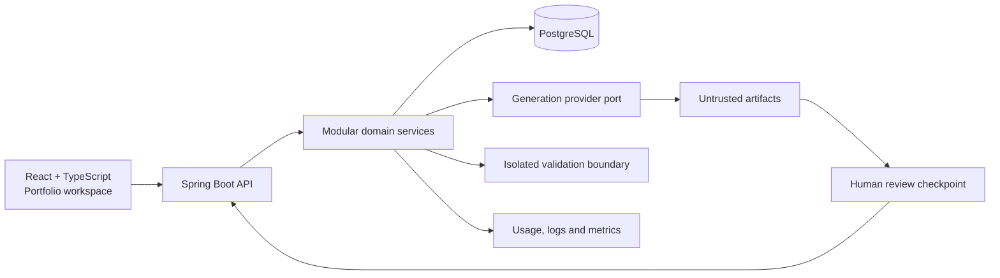

# AI Engineering Platform

AI Engineering Platform is an AI-assisted software engineering workbench for turning structured requirements into reviewable project architecture and source artifacts.

It is designed as a portfolio project for demonstrating engineering judgment around AI workflows, human approval, untrusted generated code, cost visibility, and maintainable modular architecture.

> **Portfolio status:** the current repository contains a generated Java foundation and a frontend experience for the core workflow. Provider integrations, isolated artifact execution, and persistence hardening are intentionally tracked as roadmap work.

## Problem

AI coding tools can produce code quickly, but teams still need traceability, architecture decisions, validation, review, and cost control. AI Engineering Platform makes those checkpoints visible instead of treating generation as a black box.

### Target users

- Senior engineers and architects shaping a new project.
- Technical leads reviewing AI-generated implementation plans.
- Platform teams standardizing safe project generation.

## Core workflow

1. Describe a project intent and choose a technology profile.
2. Generate an architecture proposal and an initial artifact set.
3. Validate artifacts without executing generated code automatically.
4. Review warnings, trade-offs, API contracts, and database changes.
5. Approve, request changes, or reject the generation.
6. Track versions, history, usage, and estimated cost.

## Screens

The React frontend is intentionally presentation-ready for a GitHub portfolio:

- **Overview:** workspace pulse, recent projects, review queue, and cost indicators.
- **Projects:** traceable project history and status filtering.
- **New generation:** guided intent form with safety and documentation options.
- **Review queue:** approval checklist for generated artifacts.
- **Usage & cost:** token and estimated spend visualization.

The screens currently use representative local data so the product can be demonstrated independently of an LLM provider. The Java API is the integration boundary for wiring real data.

## Architecture



Generated artifacts are data, not executable instructions. A future validator must run in an isolated process with restricted permissions and no production credentials.

## Technology choices

| Area | Choice | Reason |
| --- | --- | --- |
| Backend | Java 21 + Spring Boot | Strong ecosystem for modular enterprise APIs and observability |
| Persistence | PostgreSQL + Flyway | Explicit schema evolution and relational traceability |
| Frontend | React 19 + TypeScript + Vite | Fast, typed portfolio UI with a small deployment surface |
| Documentation | Markdown + Mermaid + OpenAPI | Reviewable decisions and portable technical communication |
| Delivery | Docker Compose + GitHub Actions | Reproducible local setup and visible CI |

## Run locally

### Backend

Prerequisites: Java 21, Maven, Node.js, and Docker.

```bash
cp .env.example .env
# Change both passwords in .env before using Docker.
docker compose up --build
```

For a local backend without Docker/PostgreSQL, set the required development password and run the H2 profile:

```bash
# PowerShell
$env:FORGEFLOW_ADMIN_PASSWORD = "use-a-local-password"
mvn spring-boot:run
```

The API is available at `http://localhost:8080`. OpenAPI is available at `/swagger-ui.html`, and health is available at `/actuator/health`.
The local HTTP Basic user is controlled by `FORGEFLOW_ADMIN_USERNAME` and `FORGEFLOW_ADMIN_PASSWORD`.

### Frontend

```bash
cd frontend
npm install
npm run dev
```

The portfolio workspace is available at `http://localhost:5174`.

### Tests

```bash
mvn --batch-mode test
cd frontend
npm run build
```

The generated project includes unit and integration test foundations under `src/test`.

## Repository map

```text
src/main/java/       API, services, entities, repositories and security
src/main/resources/  application configuration and Flyway migrations
src/test/            service and controller tests
frontend/            portfolio-ready React workspace
docs/                API and project structure references
documentation/       generated architecture and operating documents
.github/workflows/   CI build and test workflow
```

## Security considerations

- Never commit provider API keys, database passwords, or JWT secrets.
- Treat all generated source as untrusted input.
- Do not execute generated code in the application process.
- Add authentication and authorization before exposing the API publicly.
- Run dependency and container vulnerability scans in CI.
- Keep synthetic data in examples; do not use patient or production data.

## Known limitations

- The frontend currently uses representative local data and is not yet connected to every API endpoint.
- Generation provider integration is represented by a boundary, not a production LLM adapter.
- Artifact validation isolation and asynchronous job execution are roadmap items.
- The generated Spring security configuration requires environment-specific secret management before deployment.

## Roadmap

1. Connect the review queue to generation and artifact APIs.
2. Add provider-neutral LLM and embedding ports with a local fake provider for tests.
3. Introduce an isolated validation worker with explicit resource limits.
4. Add project version comparison and approval audit trail.
5. Add OpenTelemetry traces, token usage aggregation, and reproducible evaluation datasets.
6. Publish screenshots and a short architecture walkthrough with the GitHub release.

## License

This project is licensed under the [MIT License](./LICENSE).

