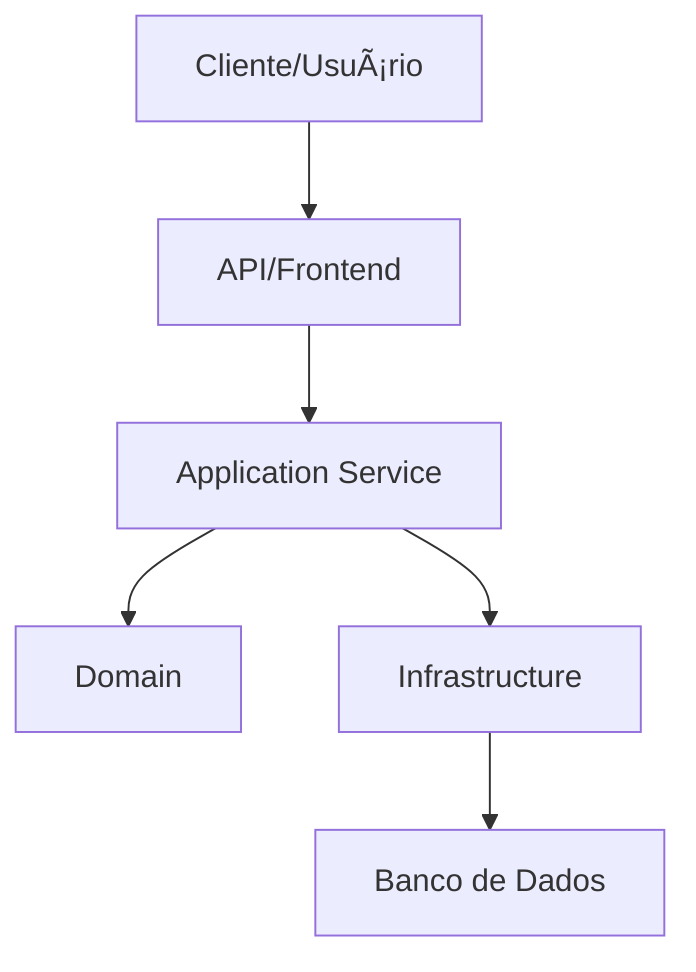

# 02. Arquitetura - AI Engineering Platform

A arquitetura escolhida para esta geração é **Hexagonal + Clean Architecture**, combinada com princípios de Clean Architecture e DDD.

## Por que esta arquitetura
- Facilita manutenção e evolução.
- Separa responsabilidades por camada.
- Reduz acoplamento e melhora testabilidade.

## Diagrama simplificado

## Responsabilidades das camadas
- Domain: regras de negócio e entidades.
- Application: casos de uso e orquestração.
- Infrastructure: integração com banco, arquivos e serviços externos.
- Interface: controllers, endpoints e UI.

## Referências oficiais
- Java: https://docs.oracle.com/en/java/
- Spring Boot: https://spring.io/projects/spring-boot
- React: https://react.dev/
- PostgreSQL: https://www.postgresql.org/docs/
- Hibernate: https://hibernate.org/orm/documentation/

